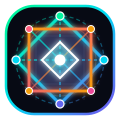
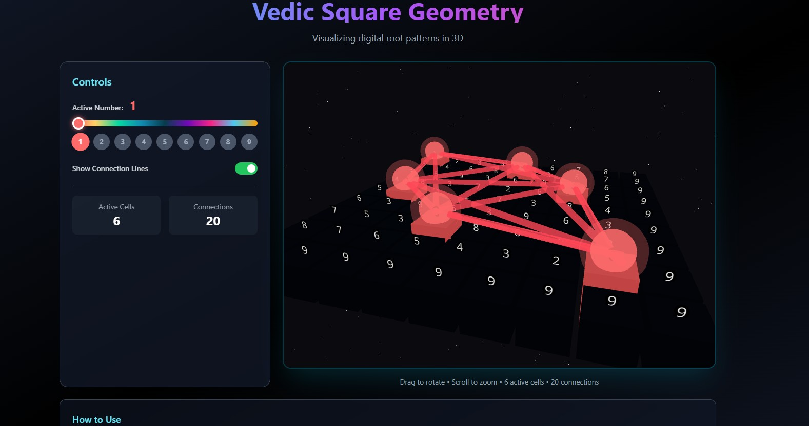

<div align="center">



# 🔮 Vedic Square 3D — Sacred Geometry & Digital Root Engine

**An interactive, high-performance 3D mathematical visualization of the Vedic Square, modular arithmetic cycles ($\text{mod } 9$), and sacred geometric symmetries.**

[](https://react.dev/)
[](https://threejs.org/)
[](https://tailwindcss.com/)
[](https://vite.dev/)
[](https://vitest.dev/)

</div>

---

## ✨ Overview

The **Vedic Square** is an ancient $9 \times 9$ multiplication grid where every cell stores the **digital root** (repeated digit sum until a single digit $1\text{–}9$ remains) of its row and column product. When specific numbers are isolated and connected across the grid, they reveal striking **reflection symmetries, star polygons, and harmonic waves**.

This application brings the Vedic Square to life inside a **real-time 3D WebGL environment** paired with a synchronized **2D SVG sacred geometry matrix** and an interactive **Digital Root Formula Inspector**.



---

## 🚀 Key Features

### ⚡ High-Performance WebGL Architecture
- **Instanced Energy Photons (`<instancedMesh>`)**: Renders up to 400 glowing light packets flowing along connection beams in a **single WebGL draw call**.
- **Precomputed Quaternions & Shared Geometries**: Connection orientations (`THREE.Quaternion`) are calculated once in memory (`computeConnections`) with module-level shared geometries, eliminating per-frame `.lookAt()` overhead and geometry thrashing.
- **Unified Frame Orchestration**: All 81 pillars, bevel caps, floating octahedron crystals, and shockwave rings animate smoothly inside consolidated `useFrame` loops.

### 🌐 4 Geometric Connection Topologies
| Topology Mode | Description |
| :--- | :--- |
| **Constellation** | Connects harmonic neighbors within a proximity threshold plus an outer angular perimeter ring. |
| **Star Mandala** | Projects radial spokes and star-polygon mirror chords across the center of the board. |
| **Wave Flow** | Traces the sequential traversal path of occurrences across rows and transpose mirrors $(r, c) \leftrightarrow (c, r)$. |
| **Full Graph** | Generates a complete all-to-all geometric web across every active node of the selected root. |

### 🌊 4 Dynamic 3D Pillar Wave Animations
- **Radial Ripple**: Concentric harmonic waves radiating outward from the center of the $9 \times 9$ matrix.
- **Harmonic Wave**: Interference standing wave oscillating across the $X$ and $Z$ multiplication axes.
- **Vortex Spiral**: Angular phase-shifted spiral wave rotating around the sacred mandala floor.
- **Steady Pillars**: Crisp static elevation steps for pure structural inspection.

### ✦ Dual Complement Symmetry ($N \leftrightarrow 9 - N$)
- Overlay any number with its **9-complement twin** (`1 ↔ 8`, `2 ↔ 7`, `3 ↔ 6`, `4 ↔ 5`, or self-dual `9`) simultaneously in contrasting neon palettes to visualize how complementary digital roots form exact geometric inversions.

### 🧭 Synchronized 2D + 3D Dashboard
- **Interactive 2D Sacred Matrix (`Matrix2D`)**: Real-time $9 \times 9$ grid with glowing SVG vector overlays synchronized with the 3D viewport.
- **Live Digital Root Inspector**: Hovering or clicking any cell in 2D or 3D displays the step-by-step arithmetic reduction (e.g., `Row 7 × Col 8 = 56 → 5 + 6 = 11 → 1 + 1 = 2`).
- **Camera View Presets**: One-click smooth transitions between **3D Isometric**, **Top Mandala** (overhead orthographic-style sacred geometry view), **Front**, and **Side** angles, plus **Auto-Orbit** and **Auto-Cycle (1–9 Tour)**.

---

## 🧮 Mathematical Foundation

### Digital Root Formula
For any positive integer $n$, the digital root $\text{dr}(n)$ is defined in modular arithmetic ($\text{mod } 9$) as:

$$\text{dr}(n) = 1 + ((n - 1) \bmod 9)$$

### The $9 \times 9$ Vedic Square Matrix

| $\times$ | **1** | **2** | **3** | **4** | **5** | **6** | **7** | **8** | **9** |
| :---: | :---: | :---: | :---: | :---: | :---: | :---: | :---: | :---: | :---: |
| **1** | 1 | 2 | 3 | 4 | 5 | 6 | 7 | 8 | 9 |
| **2** | 2 | 4 | 6 | 8 | 1 | 3 | 5 | 7 | 9 |
| **3** | 3 | 6 | 9 | 3 | 6 | 9 | 3 | 6 | 9 |
| **4** | 4 | 8 | 3 | 7 | 2 | 6 | 1 | 5 | 9 |
| **5** | 5 | 1 | 6 | 2 | 7 | 3 | 8 | 4 | 9 |
| **6** | 6 | 3 | 9 | 6 | 3 | 9 | 6 | 3 | 9 |
| **7** | 7 | 5 | 3 | 1 | 8 | 6 | 4 | 2 | 9 |
| **8** | 8 | 7 | 6 | 5 | 4 | 3 | 2 | 1 | 9 |
| **9** | 9 | 9 | 9 | 9 | 9 | 9 | 9 | 9 | 9 |

### The 9 Sacred Signatures & Mirror Pairs
- **1 ↔ 8 (Monad & Ogdoad)**: Root `1` outlines the outer hyperbola boundary, while `8` forms the inverted central diamond cross.
- **2 ↔ 7 (Dyad & Heptad)**: Interlocking hexagonal star weaves cycling in reverse modular order.
- **3 ↔ 6 (Triad & Hexad)**: Rhythmic $3 \times 3$ sub-grid lattices oscillating across rows and columns 3, 6, and 9.
- **4 ↔ 5 (Tetrad & Pentad)**: Concentric octagonal enclosures that interleave around the center.
- **9 (Ennead Supreme)**: The invariant horizon—every multiplication by 9 resolves to 9, framing the entire square.

---

## 🎮 Controls & Keyboard Shortcuts

| Input / Shortcut | Action |
| :--- | :--- |
| **`1` – `9` Keys** | Immediately switch the active digital root ($1\text{–}9$) |
| **`Space`** | Toggle **Auto-Cycle (1–9)** automated geometry tour |
| **`D` Key** | Toggle **Dual Symmetry Mode** ($N \leftrightarrow 9 - N$ complement overlay) |
| **`T` Key** | Toggle between **Top Mandala View** and **3D Isometric View** |
| **Left Click + Drag** | Orbit 3D camera around the Vedic platform |
| **Right Click + Drag** | Pan camera across the scene |
| **Scroll Wheel** | Zoom in / out |
| **Click 3D Pillar / 2D Cell** | Lock onto that cell's digital root and inspect its formula |

---

## 🗂️ Project Architecture

```text
vedic-square-simulation/
├── public/
├── screenshots/
│   └── demo1.jpg
├── src/
│   ├── components/
│   │   ├── VedicScene.jsx     # High-performance Three.js / R3F 3D scene & instanced effects
│   │   └── Matrix2D.jsx       # Interactive 2D 9x9 matrix with glowing SVG geometry overlay
│   ├── utils/
│   │   └── vedicMath.js       # Digital root engine, quaternion builder & theme metadata
│   ├── App.jsx                # Modern glassmorphic dashboard, telemetry HUD & controls
│   ├── app.test.js            # Vitest unit test suite for the mathematical & geometry engine
│   ├── index.css              # Tailwind CSS layers, custom slider & cosmic grid styles
│   └── main.jsx               # React 19 application entry point
├── Dockerfile
├── docker-compose.yml
├── package.json
└── vite.config.js
```

---

## 🛠️ Getting Started

### 1. Clone the Repository
```bash
git clone https://github.com/MojaveMix/vedic-square-simulation.git
cd vedic-square-simulation
```

### 2. Install Dependencies
```bash
npm install
```

### 3. Start the Development Server
```bash
npm start
```
Open **`http://localhost:5173`** in your browser.

### 4. Run Tests, Linter & Production Build
```bash
# Run Vitest unit tests
npm test

# Run ESLint code quality checks
npm run lint

# Build optimized production bundle
npm run build
```

---

## 🐳 Running with Docker

You can build and run the containerized application using Docker Compose:

```bash
docker compose up --build
```

The production preview server will be available at **`http://localhost:3000`**.

---

## 📄 License

This project is licensed under the **MIT License**.

---

## 👨‍💻 Created By **Badr Moujahid**

<div align="center">

[](https://badr-moujahid.netlify.app/)
[](https://github.com/MojaveMix)
[](https://www.linkedin.com/in/badr-moujahid-54a118286/)
[](mailto:badermouj@gmail.com)

</div>

- 🌐 **Website / Portfolio:** [https://badr-moujahid.netlify.app/](https://badr-moujahid.netlify.app/)
- 💻 **GitHub:** [https://github.com/MojaveMix](https://github.com/MojaveMix)
- 🔗 **LinkedIn:** [https://www.linkedin.com/in/badr-moujahid-54a118286/](https://www.linkedin.com/in/badr-moujahid-54a118286/)
- ✉️ **Email:** [badermouj@gmail.com](mailto:badermouj@gmail.com)

If you enjoy exploring mathematical geometry with this simulation, consider giving the repository a ⭐ on GitHub!
